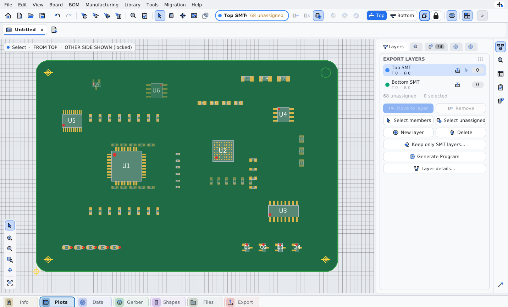
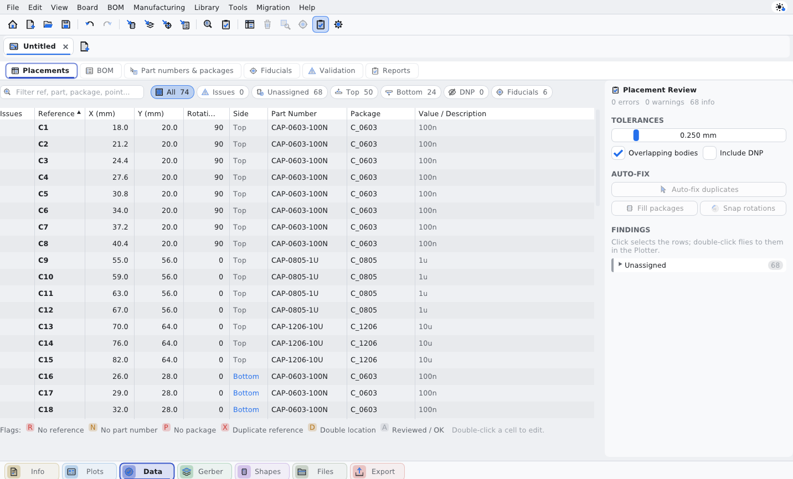
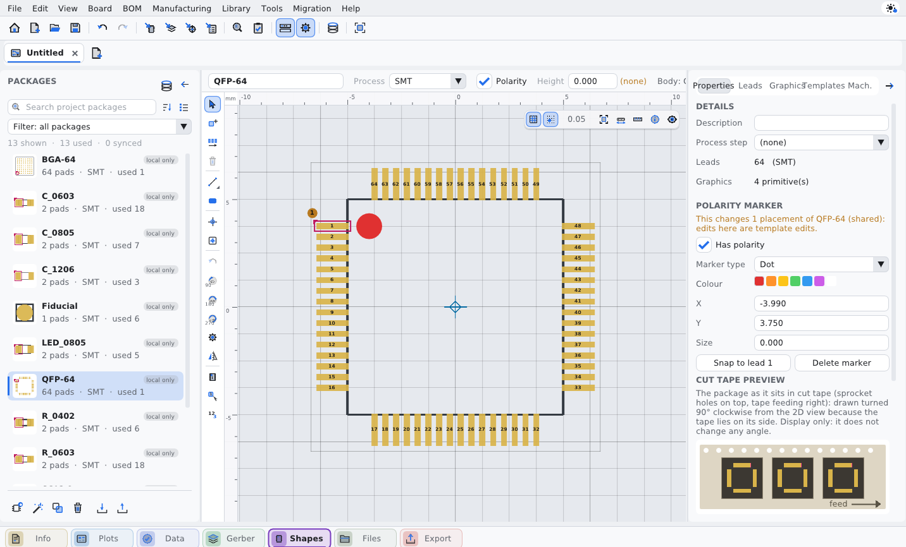
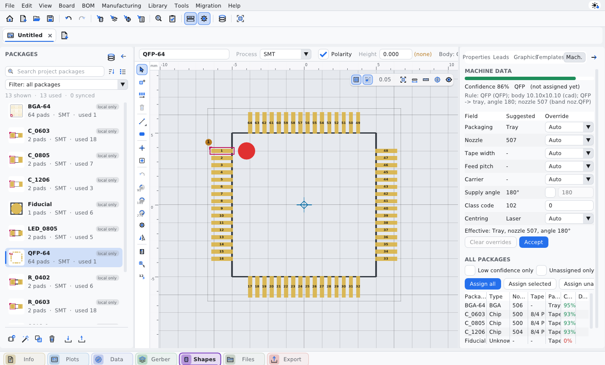
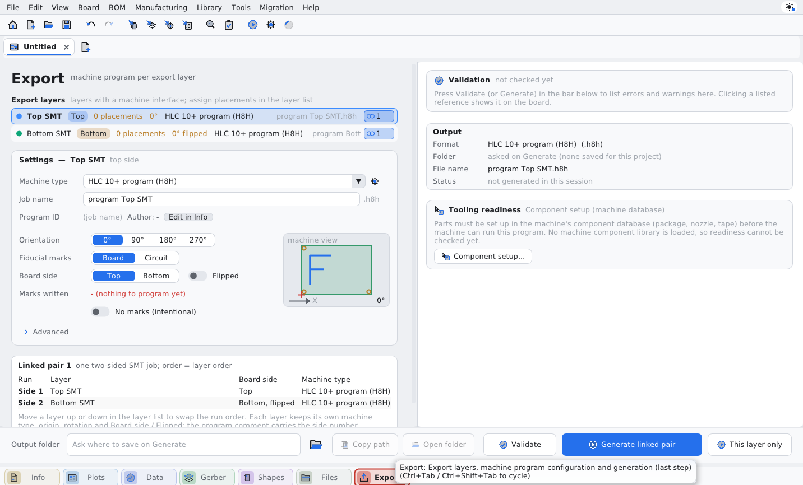

# PCB Plotter

PCB Plotter turns board design data into ready-to-run **pick-and-place and insertion programs** for a wide range of assembly machines.

You load whatever the design package provides: CAD (ODB++, IPC-2581, GenCAD, KiCad, …), Gerbers, centroid/XY files and the BOM. PCB Plotter builds an assembly model from it. In that model you check placements, fix packages and rotations, set fiducials and panelize. When the board is ready, PCB Plotter writes the program for each side of the board in the format of the target machine: JUKI, Mydata, Samsung, Europlacer, Assembleon/Philips, Universal, TWS, Dima, TDK, Contact Systems, Robotas, or generic CSV/XY.

It is a single, dependency-free Windows executable written in C++20 (Dear ImGui on Direct3D 11). It replaces an earlier WPF prototype of the same name.

> All screenshots use the fictional demo board in [`docs/demo`](docs/demo). Generate it with `python3 docs/demo/gen_demo_board.py`.

## What it does

1. **Import.** Open CAD or Gerbers, or a centroid file plus a BOM. Text files are mapped automatically: delimiter, units, column roles, reference ranges such as `C1-C25` and DNP. Board photos or AOI images can be registered underneath the board.
2. **Review.** A placements grid flags missing part numbers, duplicate references, overlapping bodies, package mismatches and unassigned parts. Several of these have a one-click fix.
3. **Packages.** A package editor covers pads, body outline, height, the polarity / pin-1 marker and a cut-tape preview of how the part sits in the feeder.
4. **Machine data.** Each package gets its feeder, nozzle, tape width, pitch and supply angle. These are suggested from the package code and the CAD body size, and can be overridden. No external part database is needed.
5. **Board setup.** Set fiducials (board, circuit and component). A side without its own fiducials takes them from its linked side. Panelize with step-and-repeat and per-image offsets, and set the origin and orientation.
6. **Export.** Each export layer (Top SMT, Bottom SMT, …) becomes one machine program. Two-sided jobs are written as a linked pair (`<Job> [SIDE1]`, `[SIDE2]`). A validation pass lists problems before anything is written; it warns but never blocks the export.

| | |
|---|---|
|  |  |
| **Data**: placements grid, BOM and validation | **Shapes**: pads, body, polarity marker, tape preview |
|  |  |
| **Machine data**: suggested feeder / nozzle / tape with confidence and overrides | **Export**: per-layer machine setup, linked two-sided programs |

## Features

- **CAD import:**
  - Formats: ODB++ (folder, `.tgz`, `.zip`, including `.Z` members and a step chooser for panels and coupons), IPC-2581, GenCAD 1.4, IPC-D-356(A), KiCad `.kicad_pcb`, EAGLE `.brd`, PADS ASCII, Allegro extracts, FABmaster and Mentor neutral files.
  - A DXF file can supply the board outline.
  - Body outlines and part heights are kept when the source has them.
- **Gerber workspace:** RS-274X / RS-274D with aperture lists, and Excellon drill files. Rendering is GPU-based. It has layer roles and colours, a D-code table, and alignment of the Gerber set to the placements. A pad digitizer turns flashes into components when there is no CAD.
- **Centroid / BOM import:** CSV, TSV, fixed-width, `.xlsx` and `.ods`, with column auto-detection, reusable templates, reference-range expansion, DNP handling and BOM-to-placement reconciliation.
- **KiCad / JLCPCB BOMs:** native KiCad (`Ref/Value/Footprint/Qty`) and JLCPCB (`Comment/Designator/Footprint/LCSC`) layouts are recognised. An optional, user-initiated lookup fills *blank* manufacturer, MPN and description fields from LCSC product pages; nothing is guessed, footprints are never replaced, and the completed BOM can be exported as CSV.
- **Placement review:** filters and flags, overlap and duplicate checks, and auto-fix.
- **Package library:** pad generators and templates, a body renderer, polarity markers, usage tracking and the cut-tape preview.
- **Machine data assignment:**
  - Feeder, nozzle, tape width, pitch, carrier and supply angle are suggested per package from the package name, the BOM description and the CAD body size.
  - The suggestion shows a confidence score and the rules that fired.
  - House rules apply on top:
    - restricted nozzle set;
    - 8 mm tape is paper;
    - QFP/BGA come on trays, everything else on cut tape.
  - Your override always wins, field by field.
- **Panelizer:** image grids, step-and-repeat, linked instances, per-instance outline checks.
- **Fiducials:** board, circuit and component marks. A side without marks uses its linked side's marks, mirrored.
- **Machine programs** (one export layer per program; origin, rotation sense and units per machine):

  | Family | Formats |
  |---|---|
  | JUKI | HLC `H8H` / `H7H` / `H5H` / `H4H`, per-machine `E41..E46` / `E51`, ISS production program (XML), JaNets `.juk` |
  | Mydata | Directline `.mnt`, TPSys `.pcb`, component library `.cmp` (single / batch) |
  | Samsung | CP placement `.ssa` |
  | Europlacer / Multroniks | `.dp`, Blakell Robin `.bla` |
  | Assembleon / Philips | FTIP `.ftp` |
  | Universal | HSP `.ncz`, Radial PUT / Style 2, VCD PUT / Style 2 |
  | TWS | Quadra `.asq` |
  | Dima | PCB placement template |
  | TDK | RX-11 insertion `.ncp` |
  | Contact Systems | CS400 `.dnl` |
  | Robotas | Mascot `.asy` (MAS 1.6) |
  | Generic | flat placement file, CSV, XY |

  JUKI details:
  - Component records carry the body size (not the leads), the height, the class, tape and pitch codes, and the supply angle.
  - Existing programs can be imported back into a project. Imported programs re-export byte-for-byte.
- **Program viewer:** opens HLC / ISS programs, including machine splits, over the board's AOI image, aligned on the fiducials.
- **Job files:** each project has a sidecar job archive and an organised Files tab. It previews PDF, Office documents, spreadsheets, Jet `.mdb` tables, email (`.eml` / `.msg`) and Markdown.
- **Migration:** older CAM projects and package libraries stored in Access/Jet databases (`.cpf`, `.mdb`) import through a built-in Jet3/Jet4 reader, with no ODBC or ACE needed.
- **Plugins:** a stable C ABI (`sdk/pcbp_plugin.h`). Importers and exporters exchange JSON, and the built-in formats use the same registry.
- **Native format:** `.pcbp` is plain JSON, the same schema plugins see, so it can be diffed and scripted.
- **Desktop integration:** light and dark themes, DPI-independent vector icons, and file associations with Explorer thumbnails (`pcbp_thumb.dll`).

## Building

**Visual Studio 2026 / 2022.** Open `PCBPlotter.sln` (toolset v145) or `PCBPlotter_vs2022.sln` (v143) and build `Release|x64`. It builds C++20 with a static CRT, so the output is one exe. After adding or removing source files, run `python tools/gen_vcxproj.py`; it mirrors the source directories of the CMake build.

**CMake + MinGW-w64 (GCC).** One `CMakeLists.txt` covers three hosts. Ninja builds in parallel and tracks header dependencies.

| Host | Configure / build | Output |
|---|---|---|
| Linux → Windows (`apt install mingw-w64 cmake ninja-build`) | `cmake --preset mingw-cross && cmake --build --preset mingw-cross` | `build/mingw-cross/bin/PCBPlotter.exe`, `pcbp_thumb.dll` |
| Windows, MSYS2 UCRT64 (`pacman -S mingw-w64-ucrt-x86_64-{gcc,cmake,ninja}`) | `cmake --preset mingw-native && cmake --build --preset mingw-native` | `build/mingw-native/bin/…` |
| Linux native (core, IO and format layers + unit tests) | `cmake --preset linux-tests && cmake --build --preset linux-tests && ctest --preset linux-tests` | `build/linux-tests/tests/test_*` |

- The binaries are self-contained (`-static`): they import only system DLLs and `msvcrt.dll`, with no libstdc++ or winpthread DLLs.
- Options: `-DPCBP_WERROR=ON`, `-DPCBP_STATIC=OFF`, `-DPCBP_BUILD_TESTS=ON`. The `mingw-cross-tests` preset also builds the tests as Windows exes, and runs them through Wine when Wine is installed. That preset is the only one that builds Windows-only tests such as `test_seh_guard`.
- Sources are globbed from the same directories `tools/gen_vcxproj.py` uses. Re-run the configure step after adding or removing files.
- `tools/build_mingw.sh` (the older single-script cross build) still works.

**Tests.** `ctest` fails on a test's exit code. The older `tests/run_all.sh` is kept, but it only prints the tail of each test's output and ignores the result. Tests that need real-world files look them up by key in `tests/local_data.map`, a `key=path` list that is gitignored and never committed (see `tests/local_data.h`). When a key is not mapped, the sections that need it print `SKIP` and the synthetic sections still run.

All test fixtures in the repository are synthetic.

## Repository layout

| Path | Contents |
|---|---|
| `src/core` | document model: `Project`, `.pcbp` JSON IO, machine job builder, machine data assignment, placement checks, panelize, arrays |
| `src/io` | file formats: CAD importers, Gerber/Excellon, text/centroid/BOM import, Jet MDB, JUKI program reader/writer, document previews |
| `src/plugins` | plugin registry, built-in importers/exporters, DLL loader |
| `src/gui` | the UI (ImGui + D3D11): shell, plotter, Gerber workspace, package library, tables, export, files |
| `src/app`, `src/ui`, `src/platform` | application services, theme/icons, Windows integration (shell, PDF, crash handling) |
| `sdk` | plugin ABI header, sample plugin |
| `tests` | unit tests and synthetic fixtures |
| `tools` | build script, project generator, icon and fixture generators |
| `docs` | operator workflow, screenshots, demo board |
| `third_party/imgui` | Dear ImGui 1.91.5-docking (vendored, MIT; one patch, see `VENDORED.txt`) |

## Status

- Tested with Linux unit tests and under Wine. It has not had broad testing on real Windows machines.
- JUKI programs are checked against real machine-written files and independent parsers. The other machine formats are covered by serializer tests but have not yet been validated in the vendors' own importers; check origin, rotation and polarity on the first run.
- Some JUKI component-record fields are still being confirmed against editor resaves:
  - nozzle encoding;
  - the height field;
  - stick/tray supply angles.
- Gerber `%SR` (step and repeat) is expanded into flat geometry.

## Notes

PCB Plotter is independent software. It is not affiliated with or endorsed by any assembly-machine, component-distributor or CAM software vendor named here. Product and format names are used only to identify file formats for interoperability. No third-party code, artwork or sample data is included.

## Author and license

Written by Corey Nguyen as an independent personal project.

PCB Plotter's own code, documentation and test fixtures are released into the public domain under [The Unlicense](LICENSE). The one third-party component, Dear ImGui (`third_party/imgui`), keeps its MIT license (`third_party/imgui/LICENSE.txt`), and its copyright notice must be retained when redistributing.
